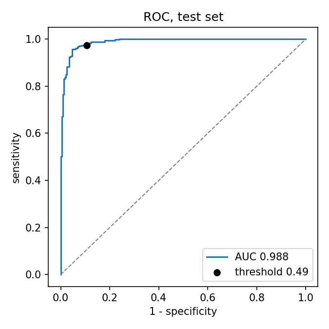
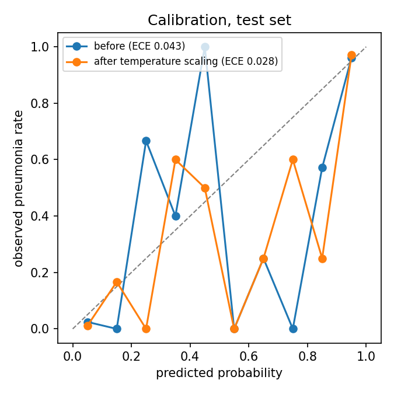
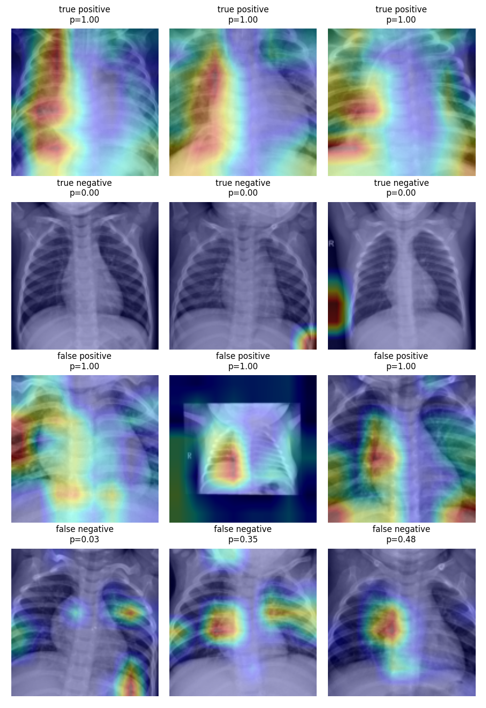
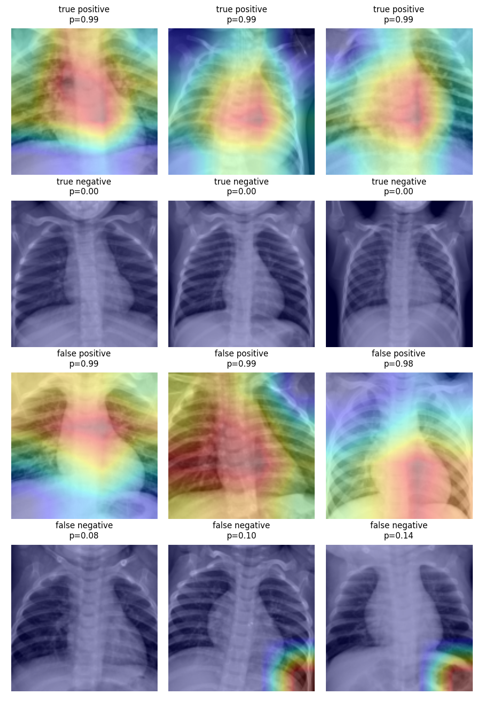

# pneumonia-xray


Pneumonia detection from pediatric chest X-rays with PyTorch. Compares a small
CNN trained from scratch with a fine-tuned ImageNet ResNet-18, picks a
decision threshold for high sensitivity, calibrates the output probabilities,
and uses Grad-CAM to check what the models are looking at.

## Data

[PneumoniaMNIST](https://medmnist.com/) at 128x128, from MedMNIST v2. It's a
resized version of the pediatric chest X-ray dataset from
[Kermany et al. (2018)](https://doi.org/10.1016/j.cell.2018.02.010), collected
at a single hospital in Guangzhou from children aged 1 to 5.

| split | images | pneumonia |
|---|---|---|
| train | 4,708 | 74% |
| val | 524 | 74% |
| test | 624 | 62% |

The test set comes from a different split of the original data and has a
different class balance, which matters for the threshold and calibration
results below.

## Results

Test set. The threshold for each model was chosen on the validation set as
the highest one that still gives 95% sensitivity.

| | parameters | AUC (95% CI) | sensitivity | specificity | PPV | NPV |
|---|---|---|---|---|---|---|
| Small CNN | 1.2M | 0.987 (0.980-0.994) | 0.982 | 0.927 | 0.958 | 0.969 |
| ResNet-18, pretrained | 11.2M | 0.988 (0.981-0.994) | 0.974 | 0.893 | 0.938 | 0.954 |

The confidence intervals are from 1,000 bootstrap resamples of the test set.
The two models aren't distinguishable on AUC. ImageNet pretraining didn't
help here, which isn't too surprising for 128x128 grayscale images with
almost 5,000 training examples.

Both models score about 0.998 AUC on validation and 0.987 on test. The gap is
probably the shift between the splits rather than overfitting, since
validation AUC was still flat or rising when training stopped.

Out of 390 pneumonia cases in the test set, the CNN missed 7 and the ResNet
missed 10.

### Calibration

Temperature scaling, fit on validation logits:

| | temperature | ECE before | ECE after |
|---|---|---|---|
| Small CNN | 1.14 | 0.048 | 0.051 |
| ResNet-18 | 1.64 | 0.043 | 0.028 |

The ResNet was overconfident and temperature scaling helped. The CNN was
already close, and the small change made it slightly worse on test. A
temperature fit on 74% pneumonia data doesn't fully carry over to a test set
with 62%.

 

### Grad-CAM

Most confident examples of each outcome on the test set.

| Small CNN | ResNet-18 |
|---|---|
|  |  |

- The CNN's heatmaps mostly land on the lung fields. The ResNet's are coarse
  blobs over the middle of the chest, because its last conv layer is only 4x4
  at this input size.
- One of the CNN's false positives is a shrunken image with black borders and
  an "R" marker. The model may be reacting to the image format rather than
  the lungs. Shortcuts like this are a known problem with chest X-ray datasets.
- Two of the ResNet's false negatives focus on the bottom-right corner, away
  from the lungs.
- True negatives show almost no heatmap. Grad-CAM keeps only regions that push
  the score towards pneumonia, and there aren't any.

## Usage

```
python3 -m venv .venv
source .venv/bin/activate
pip install -r requirements.txt

python -m xray.train --model cnn --epochs 30
python -m xray.train --model resnet18 --epochs 15
python -m xray.evaluate --model cnn
python -m xray.evaluate --model resnet18
python -m xray.predict examples/pneumonia.png --heatmap heatmap.png
pytest
```

The dataset (about 80 MB) downloads on first use. Training takes about 10
minutes for the CNN and 4 minutes for the ResNet on an M-series MacBook Air.
Checkpoints go in `runs/` and aren't committed, so train before running
`evaluate` or `predict`.

## Code

- `xray/data.py`: loading, normalization, augmentation (small rotations,
  shifts and zoom; no horizontal flips, since the heart is on the left)
- `xray/models.py`: the small CNN and the ResNet-18 adapted to one channel.
  The pretrained first-layer RGB filters are summed into one grayscale filter.
- `xray/train.py`: AdamW with a one-cycle learning rate schedule, keeps the
  checkpoint with the best validation AUC
- `xray/metrics.py`: sensitivity/specificity, threshold selection, bootstrap
  CI, ECE, temperature scaling
- `xray/gradcam.py`: Grad-CAM using hooks on the last conv layer
- `xray/evaluate.py`: test metrics and plots
- `xray/predict.py`: prediction and heatmap for a single image
- `tests/`: unit tests

## Limitations

- Not a medical device. The data is from one hospital and one age group, and
  the model hasn't been tested on anything else.
- 128x128 is much lower resolution than a real X-ray.
- The dataset only separates normal from pneumonia. It can't distinguish
  bacterial from viral pneumonia or detect other conditions.

## License and credits

Code: MIT. Data: PneumoniaMNIST, CC BY 4.0. Yang, J. et al. "MedMNIST v2: A
large-scale lightweight benchmark for 2D and 3D biomedical image
classification." Scientific Data, 2023. The images in `examples/` come from
its test set.
